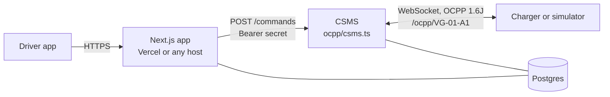
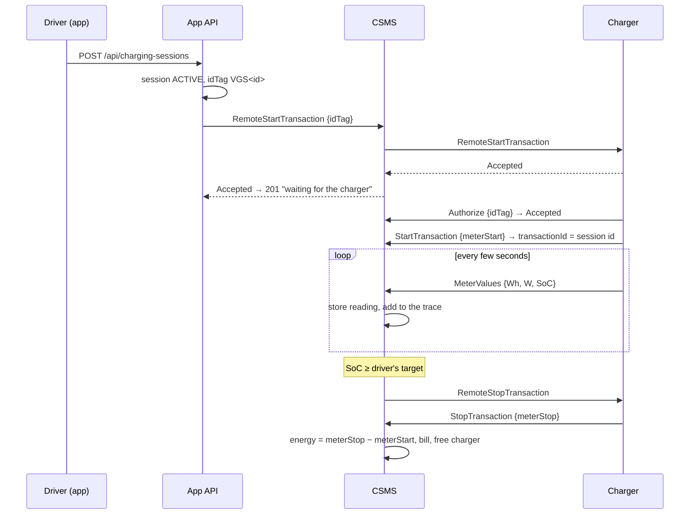

# OCPP

[← back to README](../README.md)

Volt Grid can run real chargers. OCPP (Open Charge Point Protocol) is the open
standard chargers use to talk to the system that manages them, called the
CSMS. This repository includes:

- **a CSMS** (`ocpp/csms.ts`) that speaks OCPP 1.6J, the JSON-over-WebSocket
  version most chargers on the market support;
- **a charge-point simulator** (`ocpp/sim.ts`) that behaves like the hardware,
  so the whole flow can be run without a charger;
- **an OCPP console** in the admin app (`/admin/ocpp`). It lists the connected
  charge points and every message they exchange, and lets an admin send them
  commands.

None of this is required. When `OCPP_CSMS_URL` isn't set, every charger runs
as a simulated session along the charge curve, as before.

## How the pieces fit



The app never opens a socket to a charger. Long-lived WebSockets don't fit
serverless functions, so the CSMS is a separate Node process that keeps them
open. The app asks it to send a command over HTTP, using a shared secret.

Both processes use the same database:

- the CSMS writes what the chargers report;
- the app reads it the same way it reads everything else, including over the
  live SSE stream.

## A session over OCPP



What changes for an OCPP session:

- **Energy and cost come from the meter.** Energy is the rise in the
  charger's energy register (`Energy.Active.Import.Register`). Power and state
  of charge are its latest reading. Only the time to target is still
  estimated, from the charge curve.
- **The power chart draws real readings.** The solid line is the meter trace;
  the dashed line is the model from the current state of charge to the target.
- **The CSMS stops at the target.** OCPP 1.6 has no way to tell a car "stop at
  80%". The CSMS watches the reported SoC and sends RemoteStopTransaction.
- **If the charger refuses**, the start returns `409`, the session is
  removed and the charger is freed. The same happens if the charger doesn't
  answer.
- **Stopping from the app** sends RemoteStopTransaction and waits for the
  charger's StopTransaction. If the charger is gone, the app closes the
  session from the last reading.

Charger state follows StatusNotification: Available, Charging, Unavailable →
Maintenance, Faulted → Offline. One exception: "Available" doesn't free a
charger that the app has already given to a driver.

## Messages supported

| Direction | Message | What the CSMS does |
|---|---|---|
| charger → CSMS | BootNotification | Records vendor, model, firmware; accepts with a 30 s heartbeat |
| | Heartbeat | Returns the time; any message marks the charger online |
| | StatusNotification | Maps the connector state onto the charger |
| | Authorize | Accepts only a tag issued for an active session on that charger |
| | StartTransaction | Links the transaction to the session; refuses foreign or reused tags |
| | MeterValues | Energy (Wh or kWh), power (W or kW), SoC; stops at the target |
| | StopTransaction | Bills from `meterStop` and frees the charger |
| | DataTransfer | `UnknownVendorId` |
| CSMS → charger | RemoteStart/StopTransaction | Sent for the app |
| | Reset, ChangeAvailability, TriggerMessage | From the admin console |

Malformed frames are answered with the OCPP error codes:

| Problem | Error code |
|---|---|
| Not a valid frame | `FormationViolation` |
| Missing field | `OccurenceConstraintViolation` |
| Wrong type | `TypeConstraintViolation` |
| Bad value | `PropertyConstraintViolation` |
| Unsupported action | `NotImplemented` |

A connection without the `ocpp1.6` subprotocol is refused with `400`, and an
identity that isn't a known charger with `404`. If
`OCPP_CHARGER_PASSWORD` is set, chargers must send HTTP Basic
`<identity>:<password>` (OCPP security profile 1); use `wss://` in
production.

## Charge-point identities

Every charger has an identity, `VG-<station>-<code>`. For example, charger A1
at station 1 is `VG-01-A1`. A charger connects to
`ws://<csms>/ocpp/VG-01-A1`. The seed and the migration assign identities to
existing chargers, and new chargers get one when they are created.

## Running it locally

```bash
# .env
OCPP_CSMS_URL="http://localhost:9220"
OCPP_COMMAND_SECRET="any-long-random-string"

npm run dev                                   # the app
npm run ocpp:csms                             # the CSMS on :9220
npm run ocpp:sim -- --station 1 --speed 20    # four chargers at station 1, 20× faster
```

Then:

1. Open station 1. Its chargers show an **OCPP** chip.
2. Start charging on one of them. The charging page shows **Waiting for the
   charger** and then the live meter readings.
3. Open **Admin → OCPP console** to watch the frames go by.

Simulator options:

| Option | What it sets |
|---|---|
| `--id VG-01-A1` | One charger |
| `--station 1` | Every charger at a station |
| `--speed 20` | Simulated time runs faster than real time |
| `--soc 30` | The car's battery level when it plugs in |
| `--battery 75` | Battery size in kWh |
| `--interval 5` | Seconds between meter readings |
| `--kw 150` | The charger's rating. By default the simulator asks the CSMS for it |
| `--url wss://…/ocpp` | Which CSMS to connect to |
| `--password …` | HTTP Basic password, if the CSMS requires one |

A real charger connects the same way: set its central system URL to
`ws(s)://<csms>/ocpp/` and its charge point ID to the charger's identity.

## Deploying the CSMS

The CSMS needs a host that keeps WebSockets open, such as Render, Railway or
Fly. Vercel won't work. `render.yaml` declares it as a second service,
`volt-grid-csms`:

- start command `npm run ocpp:csms`;
- health check `/health`;
- `OCPP_COMMAND_SECRET` is generated, and the app's copy is wired to it.

Set `DATABASE_URL` to the app's database. Then set `OCPP_CSMS_URL` on the app
to the CSMS's public URL. On Vercel, add both variables in the project
settings.

Render's free instances sleep when idle. A connected charger's traffic keeps
the CSMS awake; the first connection after a sleep takes a few seconds.

## Tests

`npm run test:ocpp` needs the app and the CSMS running. It plays a charge
point over a raw WebSocket and covers:

- the handshake rules;
- every message above, and every error code;
- a full metered session;
- the automatic stop at the target;
- a refused start;
- the console and its permissions;
- a disconnect;
- a simulator run from start to finish.

CI starts the CSMS next to the app and runs it on every pull request.
